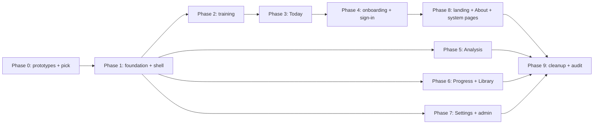

# UI_OVERHAUL.md: Full UI and UX overhaul plan

This plan defines the full UI and UX overhaul of Mainline. It records every decision from the design interview (October 2026), the parts that stay unchanged, and the PR sequence to ship the work.

## Context pointers

- Read [VISION.md](file:///home/joebos/programming/Mainline/planning/VISION.md) first. Section 2 (honesty) and section 3 (no manipulative engagement) constrain every screen in this plan.
- Read the frontend-design skill (`.agents/skills/frontend-design/SKILL.md`) before you build any UI.
- Read the unslop skill (`.agents/skills/unslop/SKILL.md`) before you write any copy.
- Read [METHODOLOGY.md](file:///home/joebos/programming/Mainline/planning/METHODOLOGY.md) section 8 before you change evidence grades, rationale copy, or board affordances.

---

## 1. Why we do this

The current UI works, but it does not feel good. The interview found four concrete problems:

1. **Clutter.** Cards sit inside cards. Mono uppercase labels sit above almost every block. The Today page has four green buttons that start the same thing.
2. **Phone use.** The navigation takes two rows. About disappears on phones. On the puzzle screen, the controls sit below the fold.
3. **Training flow.** After each block, the user goes back to Today. Two timers tick during reflective puzzles. Right and wrong feedback lives in a side panel, away from the board.
4. **No single feel.** Button styles differ (uppercase on Progress, sentence case on Today). Page widths differ. The background grid stops halfway down long pages.

The goal: a calm, clear app that a player opens every day, does one obvious thing, and closes with a sense of progress. It must work equally well on a phone and on a desktop.

---

## 2. Decision log

Every decision below is settled. Change one only with the owner's approval.

| #   | Topic                     | Decision                                                                                                     |
| --- | ------------------------- | ------------------------------------------------------------------------------------------------------------ |
| 1   | Main problems             | Clutter, phone use, clunky training flow, and a general "doesn't feel good yet".                             |
| 2   | Visual identity           | Build 2-3 directions as HTML prototypes. The owner picks one. One direction is a refined current look.       |
| 3   | Device priority           | Phone and desktop are equal on every screen.                                                                 |
| 4   | Scope                     | Everything: landing, sign-in, onboarding, Today, training, Analysis, Library, Progress, Settings, About, errors. |
| 5   | Dark mode                 | Follow the device setting by default. Add a manual switch (System, Light, Dark) in Settings.                 |
| 6   | Shipping                  | Phased PRs. Foundation first, then one PR per area.                                                          |
| 7   | Navigation                | Bottom tab bar on phones. Slim top bar on desktop.                                                           |
| 8   | Nav items                 | Today, Analysis, Library, Progress. About moves to the account menu and the footer.                          |
| 9   | During training           | Focus mode. No app nav. The board fills the screen. One small exit control.                                  |
| 10  | Today page                | One big Start or Continue action. The block list stays visible but quiet. Why and Skip sit in a small menu.  |
| 11  | After a block             | Auto-advance through a short in-between screen.                                                              |
| 12  | Prototype format          | Real HTML prototypes of Today and the puzzle screen.                                                         |
| 13  | Evidence grades           | Plain words first ("Strong evidence"). The chess glyph is a small accent.                                    |
| 14  | "Why this?"               | One control everywhere. It opens a sheet: bottom sheet on phones, side panel on desktop.                     |
| 15  | Board and pieces          | One curated default. 3-4 board and piece choices in Settings, one of them high contrast.                     |
| 16  | Sound                     | Move, capture, and check sounds, on by default, with a toggle. No reward sounds.                            |
| 17  | Motion                    | Calm. Piece animation, clear right/wrong feedback, one transition between blocks. Respect reduced motion.    |
| 18  | Landing page              | Rethink. The live blunder analyzer becomes the hero.                                                         |
| 19  | Analysis page             | Game list first. PGN import becomes an "Import PGN" button that opens a sheet.                               |
| 20  | Progress page             | Effort and consistency first. Skill estimates with uncertainty second. Rating last.                          |
| 21  | Settings                  | Sections: Plan, Board and sound, Appearance, Accounts (absorbs Connections), Privacy and data. Admin tools move to `/admin`. |
| 22  | Onboarding                | One linear flow, one step per screen, with a progress indicator and "Skip for now" where allowed.            |
| 23  | `/train` demo sandbox     | Remove it from the user-facing app.                                                                          |
| 24  | Accessible primitives     | Add Radix UI primitives under our own styled components.                                                     |
| 25  | References                | Lichess, calm productivity apps (Things, Linear), printed chess books and scoresheets, old chess clocks and wooden sets. Nothing gamey. |
| 26  | Wordmark                  | Open to redesign. Show options with each direction.                                                          |
| 27  | Copy                      | Rewrite all UI copy with STE and unslop, area by area, in the same PR as the redesign.                       |
| 28  | Quality bar               | WCAG 2.2 AA. Playwright screenshot tests at phone and desktop size per area.                                 |
| 29  | Tailwind                  | Stay on v3. Upgrade to v4 later in a separate PR.                                                            |
| 30  | Library covers            | Typographic covers: title and author in our type, colored by topic.                                          |
| 31  | Puzzle timers             | Hidden by default. Show calm block progress ("3 of 8"). A "Show time" control reveals time. The app still records time. |
| 32  | Move feedback             | On the board: square tint plus a glyph on the piece (`!` or `?`), one short line of text, then "Next".        |
| 33  | Session complete          | A calm summary: what you did, what changed in your plan, what comes tomorrow. Extras stay optional.          |
| 34  | Guest notice              | A slim notice in the top bar or account menu. A full sign-in prompt only where sync matters.                 |
| 35  | Prototype location        | `design/prototypes/` in the repo. Versioned, not shipped.                                                    |

---

## 3. What stays unchanged

The overhaul changes how the app looks, reads, and flows. It does not change what the app does.

- **Architecture.** The Engine and Methodology split, the three laws (L1, L2, L3), tRPC routers, Prisma schema, and the guards stay as they are.
- **Data and behavior.** Program generation, adaptation, FSRS scheduling, Glicko-2, guest storage in the browser, and imports keep their logic. UI components call the same procedures.
- **Board library.** `react-chessboard` and `chess.js` stay. We restyle the board through its props and our CSS. We do not swap the library.
- **Board affordance rules.** Arrows and hover highlights stay gated by methodology config (`allowArrowsByFocus`, `allowHoverByFocus`). The new board must keep these toggles. The UI must not add new hints or arrows outside that config.
- **Stack.** Next.js App Router, Tailwind v3, `class-variance-authority`, `clsx`, `tailwind-merge`, and `lucide-react` stay.
- **Headers.** COOP and COEP headers in `next.config.mjs` stay intact.
- **PWA.** The manifest and service worker stay. Icons get updated if the wordmark changes.
- **Routes.** All routes keep their URLs, with three exceptions: `/train` (removed), `/connections` (redirects into Settings), and the new `/admin`.
- **Honesty rules.** No streaks, no loss-aversion, no rating promises, no confetti.

---

## 4. Phase 0: design directions and prototypes

Phase 0 produces HTML prototypes. The owner picks one direction. Phase 1 starts only after that pick.

### 4.1 Deliverables

Create `design/prototypes/` with one folder per direction. Each folder holds plain HTML and CSS (no build step):

- `today.html`: the Today page with a session in progress (2 of 4 blocks done).
- `puzzle.html`: the puzzle screen in focus mode, with one correct-move state and one wrong-move state.
- `wordmark.html`: 2-3 wordmark options for that direction.

Each prototype must:

- Render correctly at 390 px wide (phone) and 1280 px wide (desktop).
- Show light and dark mode (a toggle button on the page is enough).
- Use real Mainline content: real block names, real rationale copy, a real puzzle position.
- Use real fonts from Google Fonts.
- Draw the board as a real 8x8 grid with SVG pieces. Do not use an image of a board.

Add `design/prototypes/index.html` that links all directions side by side. Add `design/README.md` that says these files do not ship.

### 4.2 The three directions

Each direction follows the frontend-design skill: a palette of named hex values, type roles, a layout idea, and one signature element. Colors are starting values. Check every text pair for WCAG AA contrast in the prototype.

#### Direction A: "Sheet, refined"

The current identity, cleaned up. This is the safe option.

- **Palette.** Paper `#EEF0EA`, Raised `#F8F9F5`, Ink `#15181B`, Graphite `#5A6168`, Evergreen `#2E6B50`, Clay `#A8452F`.
- **Type.** Fraunces for page titles only. Public Sans for body and controls. IBM Plex Mono for numbers only.
- **Layout.** Same single column. The graph-paper grid goes. Mono uppercase labels drop by about 80%. Cards become flat sections with spacing instead of borders.
- **Signature.** The evidence gutter: a thin bar on the leading edge of each block, tinted by its evidence grade.
- **Honest note.** This look sits close to the common "paper, serif, hairlines" default that many AI-made designs share. It is the least risky choice and the least distinctive.

#### Direction B: "Diagram"

Printed chess books and Lichess. Black print on white paper, with one spot color, like a two-color chess book.

- **Palette.** Paper `#FBFBF9`, Print `#111111`, Rule `#D9D9D4`, Spot blue `#2340B8` (main actions and the main line), Mistake red `#B8382B` (wrong moves only), Quiet grey `#6B6B66`.
- **Type.** Alegreya for titles. Alegreya Sans for body and controls. Tabular figures from Alegreya Sans for numbers. Chess figurines from Noto Sans Symbols 2 where notation appears.
- **Layout.** The session reads like an annotated main line. The current and next blocks are set in bold, numbered, because blocks are a real sequence. Alternatives (skip, swap, why) sit below each block in regular weight, indented, like variations in a book. Generous spacing and 10 px corner radius avoid the dense "broadsheet" look.
- **Signature.** The main-line hierarchy: bold means "this is your path", regular means "options". It ties directly to the product name. A "Diagram" board theme (hatched dark squares, like a printed diagram) is available in Settings.
- **Risk.** Hatched squares can hurt piece readability at small sizes. Keep the hatched board as an option, not the default.

#### Direction C: "Clock"

Old chess clocks and calm productivity apps. Tactile, warm, and quiet.

- **Palette.** Enamel `#F3F3EF`, Case `#2A2623`, Brass `#A9823A` (primary action), Felt `#2F5D50` (correct, strong evidence), Flag `#C2412D` (wrong, destructive), Dial `#8C8A85`.
- **Type.** Barlow Condensed for titles and large numbers (tall, clock-face figures). Atkinson Hyperlegible Next for body and controls. It reads well at small sizes.
- **Layout.** Soft surfaces with 14 px radius, like Things. Today centers on one dial and one large round Start button.
- **Signature.** The time-budget dial on Today. The ring shows the user's daily budget. Each block is an arc sized by its planned minutes. Done blocks fill in. The dial shows plan, not a countdown. It never ticks.
- **Risk.** A dial can read as a clock under pressure. That conflicts with decision 31. The prototype must test this. If it reads as pressure, drop the dial and keep the palette.

### 4.3 Selection

The owner reviews the prototypes on a phone and a desktop. The owner picks one direction, or asks for a mix (for example, B's layout with C's palette). Record the pick and the final tokens in `design/DESIGN.md`. That file becomes the source of truth for Phase 1.

**Gate:** Phase 1 does not start until `design/DESIGN.md` exists and the owner has approved it.

---

## 5. Foundation specification (Phase 1)

### 5.1 Design tokens

- Define all colors as CSS variables in `src/app/globals.css`, for `:root` (light) and `.dark`.
- Keep the shadcn token names (`--background`, `--primary`, and so on). Remap them to the new palette. Every existing page adopts the new palette at once, without layout changes.
- Add semantic tokens: `--surface`, `--surface-raised`, `--text`, `--text-muted`, `--accent`, `--correct`, `--mistake`, `--focus`.
- Add board tokens: `--board-light`, `--board-dark`, `--board-highlight`, `--board-correct`, `--board-mistake`.
- Remove the graph-paper background grid.
- Define one type scale (about 6 steps), one spacing scale, and 2-3 radius values. Write them in `design/DESIGN.md` and in `tailwind.config.ts`.
- Define two content widths: `reading` (about 680 px) and `wide` (about 1120 px). Every page uses one of these two.

### 5.2 Fonts

- Load at most 3 families with `next/font/google`, Latin subset, variable fonts where possible.
- Set the body font once on `body`. Remove the many repeated `font-serif` classes.

### 5.3 Theme switching

- Add `next-themes` (or an equal small script) with `attribute="class"`.
- Default: follow the device setting. Settings offers System, Light, and Dark.
- Prevent a flash of the wrong theme on first paint.
- Store the choice in `localStorage`. This works for guests and signed-in users.

### 5.4 Component kit

Build these in `src/components/ui/`. Use Radix primitives where noted. Each component has light and dark styles, a visible keyboard focus ring, and 44 px minimum touch targets on phones.

| Component       | Base                   | Notes                                                                   |
| --------------- | ---------------------- | ----------------------------------------------------------------------- |
| `Button`        | own                    | Variants: primary, secondary, quiet, danger. One case style everywhere. |
| `Surface`       | own                    | Replaces `Card`. No nested surfaces.                                    |
| `Sheet`         | `@radix-ui/react-dialog` | Bottom sheet on phones, side panel on desktop.                        |
| `Dialog`        | `@radix-ui/react-dialog` | For confirmations only.                                               |
| `Menu`          | `@radix-ui/react-dropdown-menu` | Account menu and block "more" menu.                            |
| `Tabs`          | `@radix-ui/react-tabs` | Replaces hand-rolled filters (for example All, Wins, Losses).          |
| `Tooltip`       | `@radix-ui/react-tooltip` | Desktop only. Never the only way to reach information.              |
| `ChoiceGroup`   | `@radix-ui/react-radio-group` | Replaces the large radio cards in onboarding and Settings.      |
| `Switch`        | `@radix-ui/react-switch` | Sound, show time, and similar toggles.                               |
| `Field`         | own                    | Label, input, hint, and error in one. Wraps `Input`, `Select`, `Textarea`. |
| `Progress`      | own                    | Segmented, for "3 of 8".                                               |
| `Notice`        | own                    | Replaces `StatusMessage` and `ErrorNotice` with one component.         |
| `EmptyState`    | own                    | One sentence that says what to do, plus one action.                    |
| `EvidenceChip`  | own                    | Plain words plus a small glyph. See 5.6.                               |
| `WhyButton`     | own + `Sheet`          | The single "Why this?" control. See 5.7.                               |

Replace the 18 raw `<button>` tags and the inline-styled inputs in `operations-panel.tsx` and `account-actions.tsx` with kit components while you redesign each area.

### 5.5 App shell

- **Desktop (768 px and wider).** A slim top bar: wordmark left, the four tabs in the center, account menu right.
- **Phone (under 768 px).** A slim top bar with the wordmark and account menu. A fixed bottom tab bar with the four tabs, icons plus labels. Respect `env(safe-area-inset-bottom)`.
- **Account menu.** Settings, About, Feedback, Sign out (or Sign in for guests). The slim guest notice lives here and in the top bar.
- **Focus layout.** A separate layout for training routes. No tabs, no top bar. One exit control in a corner. Exit asks for confirmation only if leaving loses progress.
- **Footer.** On public pages only: About, Methodology, source code, privacy.

### 5.6 Evidence chip

Grade labels stay in `src/components/evidence.tsx`. Change the display only:

| Grade | Glyph | New label          |
| ----- | ----- | ------------------ |
| A     | `!!`  | Strong evidence    |
| B     | `!`   | Some evidence      |
| C     | `?!`  | Best guess         |
| D     | `??`  | Not supported      |

- The label comes first. The glyph is small and decorative (`aria-hidden`).
- The accessible name reads, for example, "Strong evidence, chess-specific".
- Final wording needs a check against METHODOLOGY.md section 8 in Phase 1.

### 5.7 The "Why this?" control

- One component, one look, on every screen that shows a recommendation.
- It opens a `Sheet` with: the rationale, the evidence chip, the tier note, and the citations.
- It replaces the inline "WHY THIS? (CLICK TO EXPAND)" blocks, `methodology-rationale-card.tsx`, and the citation popovers in `evidence.tsx`.

### 5.8 Board

- Restyle `src/components/interactive-board.tsx` with board tokens.
- Ship one curated default board and piece set that fits the chosen direction.
- Offer 3-4 board choices in Settings. One must be high contrast.
- Check every piece set license before you add it. The repo is AGPL-3.0. "GPL-2.0-only" art is not compatible. "GPL-2.0-or-later", CC0, CC-BY, and MIT are fine.
- The board fills the available width on phones, with a small side margin.
- Coordinates sit inside the board edge, in a muted color.
- Move feedback (decision 32): a tint on the destination square and a glyph badge (`!` or `?`) on the moved piece. The glyph must not depend on color alone.

### 5.9 Sound

- Three short sounds: move, capture, check. Optional: a soft sound for a wrong move.
- No sound for "correct", "block done", or "session done". Those would act as rewards.
- On by default. A toggle sits in Settings and in the focus-mode menu.
- Files under 20 KB each, loaded lazily. Use CC0 sources or create our own. Check the license.
- Store the setting in `localStorage`.

### 5.10 Motion

- Pieces animate on move (about 150 ms).
- Feedback tints fade in (about 120 ms).
- The in-between screen after a block has one short entrance (about 250 ms).
- Sheets slide in.
- Nothing else animates. Under `prefers-reduced-motion: reduce`, all of the above become instant.
- CSS only. No animation library.

### 5.11 Screenshot test setup

- Add a Playwright project for visual tests with two viewports: 390 x 844 and 1280 x 800.
- Run each visual test in light and dark mode.
- Use guest-mode fixtures so tests need no auth.
- Mask dynamic content (dates, times, random puzzles).
- Generate baselines in the official Playwright Docker image, so fonts match CI.

---

## 6. Area specifications

Each area below is one PR (see section 9). Each area spec lists what changes and what the user can see and test.

### 6.1 Training (focus mode)

Files: `src/app/train/[itemId]/train-item.tsx` (1,245 lines), `endgame-drill.tsx`, `unavailable-training-block.tsx`, and the board.

- Use the focus layout. No app nav.
- **Phone:** block progress and exit at the top, the board in the middle, the prompt and actions at the bottom within thumb reach. The whole puzzle fits in one screen at 390 x 844 without scrolling.
- **Desktop:** the board on the left (as large as fits), a narrow panel on the right with prompt, feedback, and actions.
- Show the prompt in plain words ("Black to move. Find the best move."). Remove the "Current puzzle" title.
- Hide both timers (decision 31). Show "3 of 8" progress. A "Show time" control in the focus menu reveals time for that session.
- Move feedback on the board (decision 32), one short text line, then a "Next" button.
- **In-between screen (decision 11):** after a block, show one line about what was done, the next block name and its length, and a "Continue" button. A quiet "Back to Today" link sits below.
- Keep the methodology gates for arrows and hover.
- Remove `/train` and `train-demo.tsx`. Move any fixtures that unit tests use to `tests/`. Update `tests/e2e/train.spec.ts` and the `/train` request in `tests/e2e/pwa.spec.ts`.
- Calibration (onboarding) and blunder drills reuse the same focus layout and board.

**The user can test:** start a block on a phone, solve a puzzle without scrolling, see the feedback on the board, and move to the next block without going back to Today.

### 6.2 Today

Files: `src/app/today/*` (`today.tsx` is 883 lines).

- One primary action at the top: "Start session", "Continue", or "Session done".
- Below it, the block list. Each row shows the name, the planned minutes, and its state (done, next, skipped). Only the next block is emphasized.
- Each row has one "more" menu with "Why this?", "Skip", and "Undo skip".
- Remove "Mark done" from the list. A block completes through training, or through the in-between screen for external blocks.
- Move "How much time do you have today?" into a small "Change time" control that opens a sheet.
- Remove the "Planned / Actual, measured" panel from the top. Show planned minutes next to the primary action. Show actual minutes in the session-complete summary.
- **Session complete (decision 33):** what you did (blocks, minutes), what changed in your plan, and what comes tomorrow. Optional extras below: log a game, log reading. No streaks, no confetti.
- Program history moves below the fold or into Progress. Decide this in the PR.
- Guest notice: slim, in the shell (decision 34). The full sign-in prompt appears on the session-complete summary for guests.

**The user can test:** open Today and see one obvious next step. Finish all blocks and see an honest summary.

### 6.3 Onboarding and sign-in

Files: `src/app/onboarding/*`, `src/app/signin/page.tsx`.

- One linear flow: time budget, then main format, then where you play, then connect accounts, then calibration, then your starting profile, then Today.
- One question per screen. A progress indicator shows the step.
- "Skip for now" appears on optional steps (connect accounts, calibration).
- Remove the two-path choice ("Build my first session" versus "Continue setup").
- Replace the large radio cards with `ChoiceGroup`. Keep one line of explanation per choice.
- Rename "Board modality" to "Where do you play?".
- Sign-in: one short screen with Lichess, Google, and "Continue as guest". Clear text about what each option stores.
- Update `tests/e2e/onboarding.spec.ts`, `auth.spec.ts`, and the related cases in `ui-states.spec.ts`.

**The user can test:** go from the landing page to a first session in a straight line, on a phone, with one decision per screen.

### 6.4 Analysis

Files: `src/app/analysis/*`.

- Your games first, as a list. Each row shows opponent, result, date, format, and review state.
- `Tabs` for All, Wins, Losses.
- "Import PGN" and "Sync now" sit in the page header as secondary actions. Import opens a `Sheet`.
- For users without a connected account: an `EmptyState` with "Connect a chess account" and "Import PGN".
- The game review flow (`game-analysis-*.tsx`) uses a layout like training: board first, but with the app nav visible. Desktop: board left, moves and feedback right. Phone: board top, panel below.
- The bulk analysis queue (`analysis-session.tsx`) shows calm progress ("Analyzing game 3 of 12") and can run while the user leaves the page, as now.
- Update `analysis.spec.ts` and the PGN cases in `wave1-edge-journeys.spec.ts`.

**The user can test:** open Analysis and see their games at once. Import a PGN from the header.

### 6.5 Progress

Files: `src/app/progress/progress-dashboard.tsx` (762 lines).

- Order: this week's effort, then consistency over 4 weeks, then skill estimates with uncertainty bands, then rating noise.
- Fix the consistency grid. It must render as a compact 7 x 4 calendar.
- One button style across the page.
- Empty states say what to do in one sentence, with one action.
- The page-level "Why this?" uses the shared control.

**The user can test:** open Progress and read effort first. The calendar looks like a calendar.

### 6.6 Library

Files: `src/app/library/library-view.tsx`.

- A shelf of typographic covers (decision 30). Each cover shows title and author in our type, colored by topic.
- Tap a cover to open a `Sheet` with the study protocol, the reading log, and "Why this book?".
- Owned books appear first.

**The user can test:** browse books as a shelf, open one, and log reading.

### 6.7 Settings and admin

Files: `src/app/settings/*` (about 1,850 lines across 5 panels), `src/app/connections/connections-manager.tsx`.

- Sections: Plan, Board and sound, Appearance, Accounts, Privacy and data.
- Desktop: a section list on the left, the section on the right. Phone: a list of sections, each opens its own screen.
- Proposed URLs: `/settings/plan`, `/settings/board`, `/settings/appearance`, `/settings/accounts`, `/settings/privacy`. `/settings` shows the list. Confirm the URL scheme in this PR.
- Accounts absorbs Connections. `/connections` redirects to `/settings/accounts`.
- Appearance holds the theme switch (System, Light, Dark).
- Board and sound holds board choice, piece choice, sound toggle, and "Show time during puzzles".
- Feedback moves to the account menu as its own sheet or page.
- The Operations panel moves to `/admin`. Keep the existing admin access check. Admin keeps a plain, functional style.
- Update `settings.spec.ts`, `recovery-drill.spec.ts`, `core-loop.spec.ts` (feedback form), `privacy-lifecycle.spec.ts`, and the Disconnect case in `wave1-edge-journeys.spec.ts`.

**The user can test:** change the theme, the board, and the sound in Settings and see the change at once.

### 6.8 Landing, About, and system pages

Files: `src/app/page.tsx`, `src/components/homepage-blunder-analyzer.tsx`, `src/app/about/page.tsx`, `not-found.tsx`, `global-error.tsx`, `(authenticated)/error.tsx`, `(authenticated)/loading.tsx`.

- **Landing hero:** the live blunder analyzer. A short headline, the username field, platform choice, and "Analyze my games". The result shows real blunders on a real board.
- Below the hero: how Mainline works (a short real sequence), the honesty principles, and sign-in.
- Remove the fake session card. The real analyzer replaces it.
- The smoke test checks the hero heading. Update `smoke.spec.ts` with the new heading.
- **About:** restyle. Keep all transparency content: methodology releases, evidence grade definitions with the new labels.
- **404 and error pages:** say what happened and what to do, in one or two sentences, with one action.
- **Loading:** replace the spinner with quiet skeletons that match each page's layout.

**The user can test:** open the landing page on a phone and analyze a username without scrolling.

---

## 7. Copy rules

These rules apply to every string the overhaul touches.

- Use ASD-STE100 Simplified Technical English and the unslop skill.
- Use sentence case for everything: headings, buttons, labels. No uppercase labels in body content.
- A button says what happens: verb plus object ("Start session", "Import PGN"). The same action keeps the same name through the whole flow.
- Name things by what the user controls, not by how the system works ("Where do you play?", not "Board modality").
- Errors say what happened and how to fix it. They do not apologize.
- Empty states say what to do next, with one action.
- No em dashes. No curly quotes.
- No rating promises. No streak or loss language.
- Methodology rationale copy stays in methodology config (L1). The overhaul may change how it is displayed, not what it says. Wording changes to rationale copy need a methodology release.

---

## 8. Quality bar

### 8.1 Accessibility (WCAG 2.2 AA)

- Text contrast 4.5:1, large text and UI parts 3:1, in light and dark mode.
- Every control works with a keyboard. Focus is always visible.
- Touch targets are at least 44 x 44 px on phones.
- Move feedback, evidence grades, and states never depend on color alone.
- The board has an accessible description of the position and the side to move.
- Sheets and dialogs trap focus and return it on close (Radix does this).
- Respect `prefers-reduced-motion`.

### 8.2 Responsive

- Test at 360, 390, 768, 1024, and 1440 px wide.
- No horizontal scroll at any width.
- The puzzle screen fits one screen at 390 x 844.

### 8.3 Tests

- Follow the strict CI order: `typecheck`, `lint`, `test`, `test:guards`, `build`, `test:e2e`.
- E2E tests check visible text. Each area PR updates its tests in the same PR as the copy change.
- Prefer `getByRole` with an accessible name. Avoid selectors that depend on long sentences.
- Each area PR adds screenshot tests for its main screens (section 5.11).
- Do not report e2e as passed if the runner exits early.

### 8.4 Performance

- Fonts: at most 3 families, Latin subset.
- Radix: import only the primitives in section 5.4.
- Sounds: lazy-loaded, under 20 KB each.
- No new chart or animation libraries.
- Keep a Lighthouse performance score of 90 or more on the landing page (mobile).

---

## 9. Phases and PRs

Each phase is one short-lived branch and one PR against `main`. The owner approves and merges each PR. Every merge deploys to production, so each PR must leave the app fully usable.

Phases 5, 6, and 7 depend only on Phase 1. They can run in parallel with phases 2 to 4. Phase 7 should land before or with Phase 2 if Phase 2 needs the board and sound settings screen. If not, Phase 2 ships board defaults and Phase 7 adds the choices.

| Phase | Branch                       | Scope                                                                                                    | Gate to merge                                                                                         |
| ----- | ---------------------------- | -------------------------------------------------------------------------------------------------------- | ----------------------------------------------------------------------------------------------------- |
| 0     | `feat/design-prototypes`     | `design/prototypes/`, `design/README.md`, then `design/DESIGN.md` after the pick.                         | Owner picks a direction and approves `DESIGN.md`.                                                     |
| 1     | `feat/ui-foundation`         | Tokens, fonts, theme switching, component kit, evidence chip, Why sheet, app shell (top bar, bottom tabs, account menu, focus layout), screenshot test setup. | All pages render with the new palette and shell. No page is broken. Nav e2e tests updated. AA contrast passes. |
| 2     | `feat/ui-training`           | Section 6.1. Board restyle, feedback, sound, hidden timers, in-between screen, removal of `/train`.        | Puzzle fits one phone screen. Auto-advance works. Methodology gates still apply.                      |
| 3     | `feat/ui-today`              | Section 6.2.                                                                                             | One primary action. Session-complete summary. Today e2e and ui-states tests updated.                   |
| 4     | `feat/ui-onboarding`         | Section 6.3.                                                                                             | Linear flow works for guests and signed-in users. Onboarding and auth tests updated.                   |
| 5     | `feat/ui-analysis`           | Section 6.4.                                                                                             | Game list first. Import sheet works. PGN e2e cases pass.                                              |
| 6     | `feat/ui-progress-library`   | Sections 6.5 and 6.6.                                                                                    | Effort-first order. Calendar fixed. Shelf works.                                                     |
| 7     | `feat/ui-settings`           | Section 6.7.                                                                                             | All sections work. `/connections` redirects. `/admin` is gated. Settings tests updated.               |
| 8     | `feat/ui-landing`            | Section 6.8.                                                                                             | Analyzer hero works on a phone. Lighthouse mobile performance 90 or more. Smoke test updated.         |
| 9     | `fix/ui-cleanup`             | Remove dead CSS (`.eyebrow`, `.eval-gutter` if unused, old classes), old components (`Card`, `StatusMessage`, `ErrorNotice`, `methodology-rationale-card.tsx`), repeated `font-serif`. Full AA audit. Screenshot review at all widths. | No unused UI code. AA audit passes. All CI checks green.                                             |

### 9.1 Mixed state between phases

Phase 1 remaps the shared tokens. From that point, old page layouts render in the new palette and type. This keeps every page usable, but some pages will look "new colors, old layout" until their phase lands. Ship phases close together to keep this window short. If a page looks broken under the new tokens, fix it in Phase 1.

---

## 10. Decisions for later

These items are open on purpose. Decide them in the listed phase.

| Item                                                        | Decide in | Current recommendation                                                     |
| ----------------------------------------------------------- | --------- | -------------------------------------------------------------------------- |
| Final palette, fonts, and wordmark                          | Phase 0   | Owner picks from prototypes.                                               |
| Final evidence label wording                                | Phase 1   | The table in 5.6, checked against METHODOLOGY.md section 8.                 |
| Default board and piece set                                 | Phase 1   | Match the chosen direction. License must be AGPL-compatible.               |
| Sound files                                                 | Phase 2   | CC0 or self-made.                                                          |
| Where program history lives                                 | Phase 3   | Below the fold on Today, or a section in Progress.                         |
| Settings URL scheme                                         | Phase 7   | Subroutes per section (section 6.7).                                       |
| Store board, sound, and theme choices in the database       | Phase 7   | No. Keep them in `localStorage` per device. This needs no migration.       |
| `guest-migration-sync.tsx` is never mounted                 | Separate  | This may be a real bug (guest data does not sync on sign-in). Investigate in its own `fix/` PR, outside the overhaul. |
| `navigation-data-prefetch.tsx` is never mounted             | Phase 1   | Mount it in the new shell, or delete it.                                   |
| Tailwind v4 upgrade                                         | After 9   | Separate PR.                                                               |

---

## 11. Out of scope

- New features or new training types.
- Changes to methodology values, rationale wording, or evidence grades themselves.
- Database schema changes.
- Internationalization.
- A native app.
- Social features, leaderboards, streaks, or rewards (VISION section 9 and section 3).
